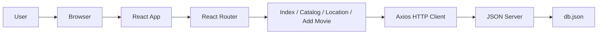

# Fantasía Videoclub

We are a team of 3 students working on this project as part of our learning process.

This is an educational project created to practice React, routing, API consumption, UI development, and teamwork in a web application context.

[](https://react.dev/)
[](https://vite.dev/)
[](https://tailwindcss.com/)
[](https://reactrouter.com/)
[](https://axios-http.com/)
[](https://github.com/typicode/json-server)

A movie catalog web app built with React and Vite. Users can explore the catalog, filter movies by category, and view details for each title.

## Requirements

- Node.js and npm

## Installation and setup

1. Clone the repository and move into the project folder.
2. Install dependencies:

   ```bash
   npm install
   ```

3. Start the mock API server in one terminal:

   ```bash
   npm run server
   ```

4. Start the frontend in another terminal:

   ```bash
   npm run dev
   ```

Open the local URL shown by Vite in the browser. The application loads its movie data from `http://localhost:3000/movies`, so keep the server running while using the app.

## Features

- Browse the movie catalog
- Sort by popularity, year, rating, or genre
- View detailed movie information
- Navigate through the app pages

## Scripts

| Command | Description |
| --- | --- |
| `npm run dev` | Start the Vite development server |
| `npm run server` | Start JSON Server using `db.json` |
| `npm run build` | Build the app for production |
| `npm run preview` | Preview the production build |
| `npm run lint` | Run ESLint |

## Architecture



### Architecture overview

- `src/App.jsx` defines the app routes and shared layout.
- `src/pages/` contains the main views: home, catalog, location, and add movie.
- `src/components/` contains shared UI elements such as navigation and page layout.
- `db.json` stores the movie catalog used by the mock API.
- `vite.config.js` configures Vite and Tailwind integration.

## Tech stack

- React
- Vite
- Tailwind CSS
- React Router
- Axios
- JSON Server
